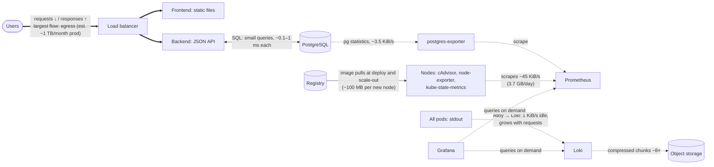

# Infrastructure analysis report

The sample application (React frontend, Go backend, PostgreSQL) with its monitoring stack, measured
on a local Kubernetes setup and specified for the cloud. The analysis covers:

- [resource usage](#1-performance-baseline);
- [bottlenecks](#2-performance-bottlenecks);
- [dependencies](#3-dependency-analysis) and [data flows](#4-data-flow-and-network-analysis);
- [security requirements](#5-security-requirements-mapping);
- [the infrastructure specification](#6-infrastructure-specification) that the
  [provider comparison](2-provider-comparison.md) and the [cost analysis](3-cost-analysis.md) build on.

## 1. Performance baseline

### How it was measured

| Part | Local setup | Cloud counterpart |
|---|---|---|
| Kubernetes | Minikube, one VirtualBox VM: 6 vCPU, 5 GB RAM, Kubernetes 1.35 | EKS / GKE Standard, three node groups |
| Ingress | Traefik 3.7 on the node's port 80, Prometheus metrics on | External / internal load balancers |
| Database | PostgreSQL 18.6 (official image), `pg_stat_statements` and I/O timing on | RDS / Cloud SQL for PostgreSQL 18 |
| Metrics | kube-prometheus-stack 93.1: Prometheus (15 s scrape), node-exporter, kube-state-metrics, Grafana | same, per environment |
| Logs | Loki 3.7 (Monolithic mode, filesystem) and Grafana Alloy 1.21 as a DaemonSet | Loki with S3 / Cloud Storage |
| Database metrics | Prometheus postgres_exporter 0.20 with the `stat_statements` collector | same, pointed at the managed database |
| Load | Locust 2.47 on the host, through the node IP like real users | — |

[`scripts/measure.py`](../scripts/measure.py) reads every number below from Prometheus for a test
window: per-component CPU and memory (cAdvisor), network bytes per pod, node disk I/O, Traefik
request metrics, PostgreSQL statistics, and the on-disk size of every volume. Each run is in
[`measurements/`](../measurements) as `summary.md`, `summary.json`, and `samples.csv` with
15-second samples.

| Run | What it shows |
|---|---|
| [01-idle](../measurements/01-idle/summary.md) | The cluster, the full monitoring stack and an empty database without traffic: the fixed cost of monitoring |
| [02-db-benchmark](../measurements/02-db-benchmark/summary.md) | pgbench, 16 clients for 5 minutes, against a separate database: what PostgreSQL itself can do on two cores |
| `03-…` application load steps | **Pending, the sample application could not be downloaded** (see [below](#application-under-load)) |

### CPU and RAM per component (idle)

| Component | CPU average | CPU peak | RAM average | RAM peak | Runs in the cloud on |
|---|---|---|---|---|---|
| Kubernetes system pods (API server, etcd, controller, scheduler, CoreDNS, proxy, metrics-server) | 113 m | 207 m | 840 MiB | 981 MiB | managed control plane (not billed as nodes) |
| Grafana | 15 m | 18 m | 434 MiB | 439 MiB | `monitoring` |
| Prometheus (42,300 series, 2,500 samples/s) | 16 m | 19 m | 288 MiB | 309 MiB | `monitoring` |
| Loki | 8 m | 10 m | 158 MiB | 160 MiB | `monitoring` |
| Grafana Alloy | 11 m | 13 m | 73 MiB | 74 MiB | every node |
| PostgreSQL (empty) | 13 m | 14 m | 45 MiB | 54 MiB | RDS / Cloud SQL |
| Traefik | 0 m | 2 m | 26 MiB | 29 MiB | load balancer |
| prometheus-operator | 4 m | 22 m | 26 MiB | 27 MiB | `monitoring` |
| kube-state-metrics | 1 m | 5 m | 21 MiB | 26 MiB | `monitoring` |
| node-exporter | 2 m | 3 m | 10 MiB | 12 MiB | every node |
| postgres-exporter | 1 m | 2 m | 8 MiB | 9 MiB | `monitoring` |
| **Monitoring stack together** | **~58 m** | | **~1.0 GiB** | | |

The VM as a whole used 0.24 of 6 cores on average and 3.5 GB of its 4.9 GB RAM. Memory, not CPU,
is the resource the setup runs out of first.

### Database: latency, throughput, storage (pgbench)

| Metric | Value |
|---|---|
| Throughput | **2,890 transactions/s** (pgbench), 20,200 statements/s |
| Latency | 5.5 ms per transaction at the client (16 concurrent clients); **0.13 ms mean statement execution** on the server (`pg_stat_statements`) |
| CPU / RAM of PostgreSQL | 1.7 cores average, 2.0 peak; 480 MiB average, 554 MiB peak |
| Cache hit ratio | 96.8% (the 300 MB data set fits in memory) |
| Storage growth | +94 MiB in 5 minutes, ~1.1 GB/h for this write-heavy synthetic load; 1.2 GB on disk with WAL at the end |
| Connections | 16 clients, 17 peak (`max_connections` 100) |

This is the database's capacity on two cores, not the app's workload. The app's queries are fewer
and simpler, so the managed instances (2 burstable vCPU on RDS, 1 dedicated vCPU on Cloud SQL) have
a wide margin.

### Disk: growth and I/O patterns

| | Idle | Database under load |
|---|---|---|
| Node disk writes | 112 KiB/s average (812 KiB/s peak), 12 write IOPS (35 peak) | **30 MB/s average** (40 MB/s peak), **3,400 write IOPS** (4,000 peak) |
| Node disk reads | 81 KiB/s, 4 IOPS | 0.4 MB/s, 20 IOPS |
| Pattern | Prometheus WAL and block writes every 2 h, Loki chunk flushes, etcd | Small random writes (WAL + table pages), almost no reads: write-bound |

- The database's write burst is right at the baseline of the cloud volumes. RDS gp3 includes 3,000
  IOPS, and the IOPS of Cloud SQL and persistent disks grow with the disk size. A write-heavy app
  would need provisioned IOPS (gp3: $0.021/IOPS-month on RDS) or a larger disk. The sample app's
  load is far lighter.
- Storage that grows on its own:

  | Volume | Growth | Projection |
  |---|---|---|
  | Prometheus TSDB | ~50 MiB/h for 42k series in its first hours | at 2,500 samples/s and 1–2 bytes per sample: 6–13 GB per 30 days; prod has ~2× the series → **50 GB volume** |
  | Loki | ~1 MiB/h of log lines idle | grows with traffic |
  | PostgreSQL | grows with the app's data | — |

### Network: internal and external traffic

Internal traffic at idle:

| Flow | Volume |
|---|---|
| Scrapes into Prometheus | 45 KiB/s (~3.7 GB/day) |
| Kubernetes system | API server and kubelet traffic ~330 KiB/s out of the system pods, mostly to the node itself |
| Logs into Loki | Alloy sends 1 KiB/s idle |

External traffic is everything through Traefik. At idle it is only a few metrics requests. Under
load it is the app's requests and responses, and it becomes the egress line of the cost analysis.

### Application under load

**Status: pending.** The sample application is published as a single zip on one server. That
server answered HTTP 502 from 2026-11-04 to the time of writing, and there is no other official
copy. Everything else for this step is ready:

- The cluster, the database the app will use, and all monitoring are running.
- The app goes into [`app/`](../app) and is deployed with its own Helm chart, the same chart the
  cloud setup will use.
- Locust 2.47 is installed. The load test steps through 100 → 250 → 500 → 1,000 concurrent users,
  10 minutes per step, then goes beyond 1,000 to find the breaking point, and finishes with a
  60-minute soak at 1,000 users for growth rates.
- `measure.py` produces the same tables as above for every step, including requests per second,
  latency percentiles, bytes per response and bytes per user.

Until then, the cost model uses stated assumptions for the app-dependent quantities: egress, log
volume and the app's share of the `main` nodes. They are listed in
[`cost-model/bom.toml`](../cost-model/bom.toml) `[params]` and are replaced by the measured values
when the run is done.

## 2. Performance bottlenecks

### Resource constraints

- **Memory of the single node.** 3.5 of 4.9 GB is in use at idle:
  - Kubernetes' own pods take 840 MiB;
  - the monitoring stack takes 1.0 GiB, about **17× the CPU share**, since its CPU is almost nothing;
  - Minikube keeps its root filesystem in RAM.

  Under load, Locust-driven pods and PostgreSQL's cache compete for the remaining ~1.4 GB.
- **Database CPU and write IOPS.** Under pgbench PostgreSQL saturated its two cores (1.7–2.0) and
  wrote 3,400–4,000 IOPS. CPU limits throughput first, then the disk's IOPS baseline.
- **Grafana is the largest monitoring component** (434 MiB at idle): plugins, the SQLite database
  and the dashboard sidecar. **Prometheus memory grows with the number of series** (cAdvisor and
  kube-state-metrics series scale with pods and nodes).

### Current scaling limitations

| Component | Limitation now | In the cloud design |
|---|---|---|
| PostgreSQL | One instance; scales only vertically; a restart is downtime | Managed HA (Multi-AZ / regional) with automatic failover; vertical resize with a short failover; read replicas possible |
| Prometheus | One replica, local disk; a pod restart loses ~2 h of in-memory head data until WAL replay | One replica per environment (HA optional with two replicas); 30 days on a zonal volume |
| Loki | Monolithic, filesystem: cannot run more than one replica | Monolithic with object storage (S3 / Cloud Storage); can move to Simple Scalable or Distributed if logs exceed ~20 GB/day |
| Grafana | SQLite on a volume: one replica | One replica is enough for a team; PostgreSQL backend if HA were needed |
| Frontend, backend | Stateless; replicas limited by one node | Horizontal Pod Autoscaler plus cluster autoscaler across three zones |
| The whole cluster | One VM, no zones: any failure stops everything | Three zones in prod, managed control plane |

### Components requiring the most resources

1. **Kubernetes control plane** (840 MiB, 0.11 core). Managed by the provider in the cloud and
   paid as the cluster fee.
2. **PostgreSQL under load** (up to 2 cores, 0.5 GB, 3,000+ IOPS). It becomes the managed database
   and its instance class is the second-largest prod item.
3. **Monitoring stack** (1 GiB together: Grafana 434 MiB, Prometheus 288 MiB, Loki 158 MiB). It
   needs its own `monitoring` node group with 8 GB.
4. **The app** itself (frontend, backend). Pending measurement; Go and nginx are typically tens of MB
   each.

## 3. Dependency analysis

### Service dependency map

### Direct dependencies

| Component | Depends on | Kind | If it is down |
|---|---|---|---|
| Frontend (browser part) | Backend API | runtime, synchronous | page loads, data doesn't |
| Backend | PostgreSQL | runtime, synchronous | API errors (5xx) |
| Backend, frontend pods | Container registry | at pod start | running pods keep working; new pods can't start |
| Backend | Secrets store (via External Secrets) | at start / refresh | existing Secret keeps working |
| postgres-exporter | PostgreSQL | runtime | database metrics missing |
| Prometheus | every scrape target | runtime, pull | metrics gaps |
| Alloy | Loki | runtime, push with retry buffer | logs buffered, then dropped |
| Loki | object storage bucket | runtime | ingestion stalls after the WAL fills |
| Grafana | Prometheus, Loki | runtime | dashboards empty |
| Argo CD | GitLab (charts, values), registry | for every sync | no deployments; running apps unaffected |
| GitLab runners | GitLab, registry, cloud IAM (OIDC) | per job | no builds |
| ExternalDNS | DNS zones API | on changes | DNS records not updated |
| Everything | Kubernetes API, DNS (CoreDNS), the node network | runtime | — |

### Shared resources

| Resource | Lives in | Used by | Note |
|---|---|---|---|
| Container registry (ECR / Artifact Registry) | `shared` | test and prod clusters (pull), CI (push) | One image is promoted from test to prod, never rebuilt. Cross-account pull permissions |
| GitLab and its runners | `shared` (runners in test) | developers, Argo CD of both clusters | Code, CI pipelines, the Helm charts Argo CD deploys |
| WireGuard VPN | `shared` | developers → test, prod, GitLab | Peered with both environment networks |
| Public DNS zone and the domain | `shared` | prod (`app.example`), test (`test.app.example` delegated) | ExternalDNS in each cluster writes only its own records |
| Terraform state bucket | `shared` | all infrastructure code | Versioned, locked |
| Billing, budgets, organisation policies | management account / organisation | everything | — |
| Not shared | — | — | Clusters, databases, monitoring (each environment has its own Prometheus, Grafana and Loki, as required), secrets, log buckets |

**What can break the migration.**

- **The registry and GitLab**: they sit in the shared account, so cross-account permissions, network
  peering and DNS must all work before the first deployment.
- **Database connectivity**: private IP only, TLS, and the new hostname in the backend config.
- **Pod Security and arm64 images**: images built only for amd64 do not start on Graviton nodes.

## 4. Data flow and network analysis

### Service interaction map with directions and volumes

Solid lines carry user traffic, dotted lines are monitoring. Volumes come from the idle and
database runs; the user-traffic volumes are filled in by the application run.

### Network usage during peak hours

At the expected peak of 1,000 simultaneous users, three flows dominate:

| Flow | Share | Why |
|---|---|---|
| Responses to users (external egress) | dominant | proportional to users × bytes per page and API response; the only flow billed per GB to the internet |
| Load balancer → pods and backend → database across zones | moderate | in prod two of three backend pods sit in a different zone from the database primary |
| Monitoring | constant | scrapes don't depend on users; logs grow with requests |

The local idle network numbers (Prometheus ingestion 45 KiB/s, system traffic ~330 KiB/s) are the
floor under the peak.

### Latency-sensitive relationships

| Path | Why it is latency-sensitive | Design consequence |
|---|---|---|
| User → load balancer → frontend / backend | user-facing response time | load balancer in the same region; keep-alive; static files cacheable |
| Backend → PostgreSQL | every API request waits for its queries; a statement takes ~0.1 ms on the server, so network round trips dominate | database in the same region and VPC; private IP; connection pooling in the backend; topology-aware routing so pods prefer their own zone |
| Kubernetes control plane ↔ nodes | scheduling, probes | managed, same region |

### Bandwidth-intensive operations

| Operation | When | Mitigation |
|---|---|---|
| Static asset delivery (JS bundle, images) to browsers | every new visitor | gzip/brotli, long-lived cache headers, CDN if traffic grows |
| Container image pulls | deploys, new nodes | images in the same region; registry endpoint / Private Google Access keeps them off NAT; small images |
| Log shipping and Loki chunk writes | continuous, grows with traffic | compression; ingestion limits; access logs at the load balancer instead of in the app |
| Prometheus scrapes | continuous | 30 s interval in the cloud where 15 s is not needed |
| Database backups and replication | continuous / daily | managed and free inside the provider (Multi-AZ / HA replication, snapshots) |
| GitLab backups to object storage | nightly | in-region bucket |

## 5. Security requirements mapping

### Accounts and projects

| | AWS | Google Cloud |
|---|---|---|
| Environments | `test` and `prod` accounts in AWS Organizations | `cc-test` and `cc-prod` projects in one folder |
| Shared resources | `shared` account: registry, GitLab VM, VPN, public DNS zone, Terraform state | `cc-shared` project |
| Billing and guard rails | management account (no workloads), SCPs | organisation: billing account, organisation policies |

### Authentication and access

**Service-to-service authentication**

| From → to | Method |
|---|---|
| Users → frontend / API | public HTTPS at the load balancer (TLS 1.2+); the app's own authentication |
| Backend → PostgreSQL | dedicated database user. The password comes from Secrets Manager / Secret Manager through External Secrets; TLS required (`rds.force_ssl`, Cloud SQL "require SSL"). IAM database authentication is possible as a next step |
| postgres-exporter → PostgreSQL | own user with only the `pg_monitor` role, TLS |
| Pods → cloud APIs (Loki → bucket, ExternalDNS → DNS zone, External Secrets → secrets, load balancer controller, autoscaler) | EKS Pod Identity / Workload Identity Federation for GKE: a cloud role per Kubernetes service account, **no static keys** |
| Nodes → registry | node role with read-only access to the shared registry (cross-account policy / Artifact Registry Reader) |
| GitLab CI → registry and cloud | OIDC: a GitLab ID token is exchanged for a short-lived role (AWS `AssumeRoleWithWebIdentity` / Google Workload Identity Federation), limited to pushing images |
| Argo CD → GitLab | read-only deploy token per repository, over the private peering |
| Inside the cluster (Prometheus → targets, Alloy → Loki, Grafana → datasources) | Kubernetes service accounts and NetworkPolicies that allow only these paths |

**User access management (RBAC)**

| Role | Cloud | Kubernetes | Argo CD | Grafana | GitLab |
|---|---|---|---|---|---|
| Platform admin (1–2 people) | admin permission set / Owner on the folder: break-glass, MFA | `cluster-admin` | admin | Admin | Owner |
| Developer | deploy rights in test, read-only in prod | `edit` in the app namespace in test, `view` in prod | sync in test, read in prod | Editor | Developer / Maintainer |
| Viewer / on-call | read-only | `view` | read-only | Viewer | Reporter |
| CI | role assumed through OIDC: push images only | own namespace for runner pods | — | — | — |

- People sign in through IAM Identity Center / Cloud Identity with MFA, using groups instead of
  per-user grants.
- Kubernetes access is mapped from those groups: EKS access entries, or GKE IAM plus RBAC with Google
  Groups.
- Argo CD and Grafana sign in through GitLab (OIDC/OAuth).

**IAM best practices applied**

- Least privilege: one role per workload, scoped to its own bucket, zone, secret or repository.
- No long-lived access keys anywhere: OIDC for CI, Pod Identity / Workload Identity for pods,
  instance profiles / service accounts for VMs.
- Separate accounts per environment, so a mistake in test cannot touch prod.
- Root and owner accounts are locked away with MFA and used only in an emergency.
- CloudTrail / Cloud Audit Logs are on in every account and project.

### Networking

**Data in transit**

- TLS everywhere users and data cross a network:
  - ACM / Google-managed certificate on the external load balancer;
  - cert-manager with Let's Encrypt DNS-01 for the internal names (Grafana, Prometheus, Argo CD,
    GitLab);
  - TLS required by the database;
  - WireGuard for developer access.
- Inside the cluster the traffic stays on the private network. NetworkPolicies limit who talks to
  whom; mTLS is a later option.

**Security groups / firewall rules**

| Source | Destination | Port | Purpose |
|---|---|---|---|
| Internet | external load balancer | 443 (80 → redirect) | the app |
| External load balancer (and Google health-check ranges 35.191.0.0/16, 130.211.0.0/22) | `main` nodes / pods | app ports | traffic and health checks |
| VPN clients 10.99.0.0/24 | internal load balancer | 443 | Grafana, Prometheus, Argo CD |
| VPN clients | Kubernetes API private endpoint | 443 | kubectl |
| VPN clients | GitLab | 443, 22 | developers |
| Internet | VPN gateway | UDP 51820 | WireGuard |
| Cluster nodes | database | 5432 | backend, postgres-exporter |
| Cluster nodes ↔ nodes | all (cluster security group / GKE rules) | — | pod-to-pod |
| Control plane | nodes | 443, 10250 | webhooks, kubelet |
| Cluster nodes (test, prod) | GitLab (shared, via peering) | 443 | Argo CD, runners |
| Nodes, GitLab | internet via NAT | 443 | updates, external APIs |
| Everything else | — | — | denied by default |

**VPN and connectivity**

- WireGuard runs on the smallest VM (t4g.nano / e2-micro) in the shared network. It is the only
  machine with a public IP besides the load balancers.
- Its network is peered with test and prod, and the gateway does source NAT, so the peering does
  not need to be transitive.
- Each developer has a key pair; removing a peer revokes access.
- AWS Client VPN would be managed and SSO-integrated, but costs ~$110+/month. Google has no managed
  client VPN.
- A third-party VPN (Tailscale and similar) is the alternative if the team wants SSO without
  running a gateway.

**No public IPs on the control plane, nodes or database**

- EKS: private endpoint only. GKE: private endpoint plus private nodes.
- Nodes sit in private subnets and reach the internet through NAT.
- RDS is "not publicly accessible"; Cloud SQL uses a private IP only (Private Service Access).
- Enforced by organisation policies.

**Load balancers and DNS**

- **External load balancer** (ALB / Google external Application LB) for the frontend and its `/api`.
- **Internal load balancer** (internal NLB / internal passthrough LB) for Prometheus, Grafana and
  Argo CD, reachable only through the VPN.
- **Public DNS zone** `app.example` in the shared account; `test.app.example` is delegated to the
  test account so its ExternalDNS cannot touch prod records.
- **Private DNS zones** `prod.internal.app.example` and `test.internal.app.example` hold the internal
  load balancer names, GitLab and the database alias.
- **Domain** from a registrar: Route 53 sells `.com` for $16/year; `.ee` domains come from Estonian
  registrars such as Zone.eu. The domain does not depend on the hosting cloud.

**Encryption at rest**

| Data | How it is encrypted |
|---|---|
| Node and volume disks | EBS encryption by default (account setting per region); Google encrypts by default |
| Databases | RDS `StorageEncrypted`, covering snapshots and backups; Cloud SQL by default |
| Buckets | S3 SSE-S3 default; Cloud Storage by default |
| Registry | ECR AES-256 by default; Artifact Registry by default |
| Secrets | KMS-encrypted in the secrets store; Kubernetes Secrets encrypted with KMS envelope encryption (EKS/GKE application-layer secrets encryption) |

Provider-managed keys cost nothing. Customer-managed keys ($1 / $0.06 per key-month) only if a
compliance rule requires them.

## 6. Infrastructure specification

### Kubernetes

| | Test | Prod |
|---|---|---|
| Service | EKS / GKE Standard (no Auto Mode, Fargate or Autopilot) | same |
| Version | in standard support (EKS 1.36 or 1.37, GKE Regular channel 1.36) | same, upgraded after test |
| Control plane | private endpoint; GKE zonal | private endpoint; GKE regional (3 zones) |
| Zones for nodes | 1 (EKS needs subnets in 2 AZs for the control plane) | 3 |
| Add-ons | VPC CNI / GKE Dataplane, CoreDNS, EBS CSI / PD CSI, metrics-server, Cluster Autoscaler, AWS Load Balancer Controller / GKE Ingress, ExternalDNS, cert-manager, External Secrets, Argo CD, GitLab runner (test) | same, without the runner |

### Node groups / pools (all with horizontal autoscaling)

| Group | Taint / label | Test | Prod | AWS type | Google type |
|---|---|---|---|---|---|
| `main` | label `pool=main` | 1 node (min 0 outside hours, max 3), Spot | min 3 (one per zone), max 6, on-demand | t4g.medium (2 vCPU, 4 GiB) | e2-medium (2 vCPU, 4 GB) |
| `monitoring` | taint `dedicated=monitoring` | 1 node (max 2), Spot | 1 node (max 2), on-demand; Prometheus/Loki volumes in one zone | t4g.large (2 vCPU, 8 GiB) | e2-standard-2 (2 vCPU, 8 GB) |
| `tools` | taint `dedicated=tools` | 1 node (max 4: CI jobs scale it), Spot | 1 node (max 2) | t4g.medium (+ t4g.large Spot for CI) | e2-medium (+ e2-standard-2 Spot for CI) |

- Pods choose their group with `nodeSelector` and tolerations.
- DaemonSets (Alloy, node-exporter, CNI) run everywhere.
- The app spreads over zones with topology spread constraints and has PodDisruptionBudgets.
- HPA: frontend and backend 2 → 10 replicas at 70% CPU.

### Compute outside Kubernetes

| VM | AWS | Google | Purpose |
|---|---|---|---|
| GitLab CE | m7g.xlarge, 4 vCPU, 16 GiB, 100 GB gp3 | e2-standard-4, 4 vCPU, 16 GB, 100 GB balanced disk | Git, CI coordination, container image builds via runners |
| VPN | t4g.nano, 8 GB gp3, public IPv4 | e2-micro, 10 GB disk, external IP | WireGuard; on AWS also NAT for the shared network |

GitLab's reference baseline is 8 vCPU / 16 GB for up to 1,000 users. A small team starts at 4 vCPU
and keeps the 16 GB GitLab needs for its bundled PostgreSQL and Redis. The VM resizes in minutes.

### Storage

| | Test | Prod |
|---|---|---|
| Managed PostgreSQL 18 | RDS db.t4g.small Single-AZ / Cloud SQL db-g1-small; 20 GB; backups 7 days; stopped outside working hours | RDS db.t4g.medium **Multi-AZ** / Cloud SQL 1 vCPU 3.75 GB **HA**; 20 GB SSD with autoscaling; daily backups kept **30 days** + PITR from logs kept **7 days** (Cloud SQL: retained backups 30, log retention 7; RDS: retention 30 days); deletion protection; encrypted |
| Prometheus | 20 GB volume, 15 days | 50 GB volume, **30 days** retention, size limit at 85% of the disk |
| Loki | 10 GB volume (WAL, cache) + bucket, 30 days | 10 GB volume + bucket, **365 days** (compactor retention; bucket lifecycle deletes after 395 days as a safety net) |
| Grafana | 5 GB volume (SQLite) | 5 GB volume |
| Registry | shared ECR / Artifact Registry: keep last 30 tags, untagged deleted after 7 days, scan on push | — |
| Encryption | everything at rest (see above) | — |

### Network

| | Shared | Test | Prod |
|---|---|---|---|
| AWS VPC / Google VPC | 10.0.0.0/16 | 10.10.0.0/16 | 10.20.0.0/16 |
| Public subnets (AWS: load balancers, NAT) | 10.0.0.0/24 | 10.10.0.0/24, 10.10.1.0/24 | 10.20.0.0/24, .1.0/24, .2.0/24 |
| Private subnets (nodes, pods with VPC CNI) | 10.0.16.0/20 | 10.10.16.0/20, 10.10.32.0/20 | 10.20.16.0/20, .32.0/20, .48.0/20 |
| Database subnets | — | 10.10.100.0/24, .101.0/24 | 10.20.100.0/24, .101.0/24, .102.0/24 |
| Google: node / pod / service ranges | 10.0.0.0/20 | 10.10.0.0/20 / 10.11.0.0/16 / 10.12.0.0/20 | 10.20.0.0/20 / 10.21.0.0/16 / 10.22.0.0/20 |
| NAT | WireGuard instance (AWS) / Cloud NAT | 1 NAT gateway / Cloud NAT | 3 NAT gateways (one per AZ) / Cloud NAT |
| Load balancers | — | external + internal | external + internal |
| VPN clients | 10.99.0.0/24 | — | — |
| Peering | ↔ test, ↔ prod | ↔ shared | ↔ shared |

### Monitoring (separate per environment)

| Part | Configuration |
|---|---|
| Prometheus | kube-prometheus-stack; ServiceMonitors for every component; 30 days in prod; scrape interval 30 s (15 s locally) |
| Grafana | behind the internal load balancer; sign-in with GitLab; datasources Prometheus and Loki of its own environment |
| Loki | Monolithic mode, object storage, 365 days in prod |
| Alloy | DaemonSet, reads `/var/log/pods` on its own node (Promtail reached end of life on 2026-03-02) |
| postgres-exporter | points at the managed database through a `pg_monitor` user; `stat_statements` collector |
| Not used | provider-managed Prometheus/Grafana (not allowed); GKE workload logging to Cloud Logging switched off |

### CI/CD

| Choice | Options compared | Decision |
|---|---|---|
| GitLab | **GitLab.com** (Free: 5 users per private group, 10 GiB per project, 400 compute minutes; Premium: $29/user/month, 10,000 minutes) vs **self-managed CE** on a VM (no licence, any number of users, inside the private network, but upgrades and backups are ours) | Self-managed CE in the shared account in the estimate, which matches the required account layout and keeps code and runners inside the private network. GitLab.com Free is the cheaper alternative for a team of ≤5 (see the cost analysis) |
| Runners | **GitLab-hosted** (compute minutes: small Linux = factor 1, $10 per 1,000 extra minutes) vs **self-managed** Kubernetes executor | Self-managed in the test cluster's `tools` group on Spot nodes: no minute quota, images built next to the registry |
| CI cost | ~15 minutes per pipeline × ~220 pipelines/month ≈ 3,300 minutes | self-managed runners: the CI node in the cost model (~$6/month on demand, ~$1 on Spot) instead of ~$29 of extra minutes |
| Continuous deployment | Argo CD in each cluster (`tools` group) watching the Helm charts in GitLab: prod doesn't depend on test, and nothing pushes into the clusters | — |
