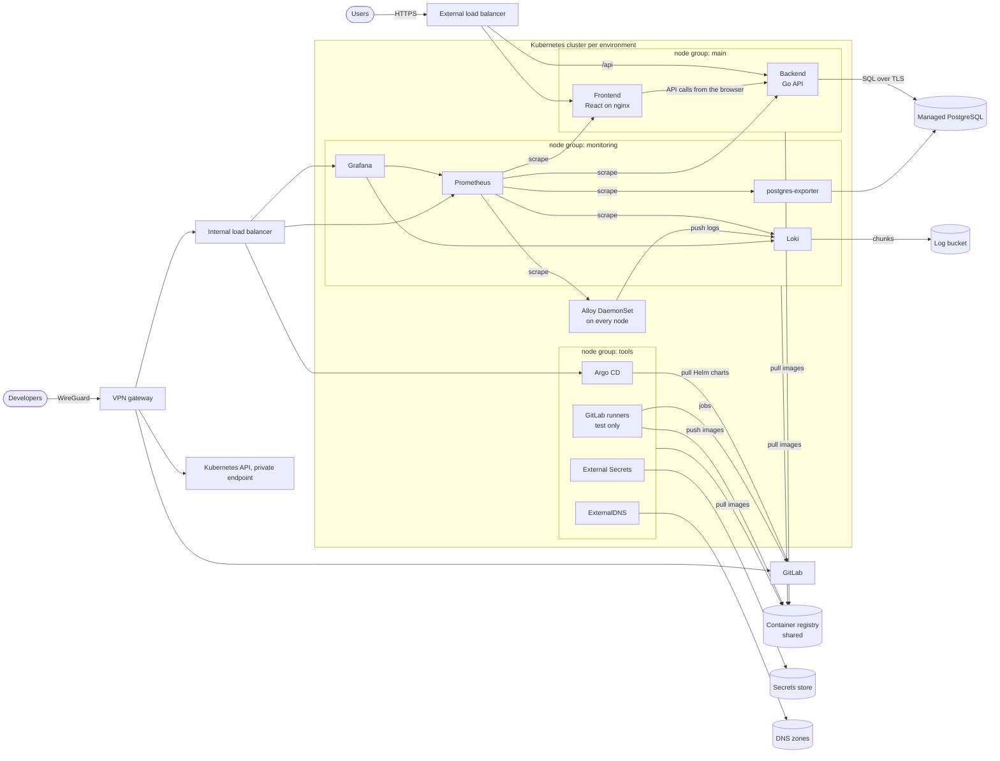
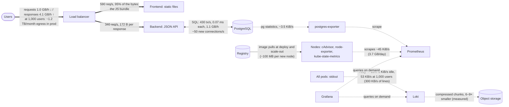

# Infrastructure analysis report

The sample application (React frontend, Go backend, PostgreSQL) with its monitoring stack, measured
on a local Kubernetes setup and specified for the cloud. The analysis covers:

- [resource usage](#1-performance-baseline);
- [bottlenecks](#2-performance-bottlenecks);
- [dependencies](#3-dependency-analysis) and [data flows](#4-data-flow-and-network-analysis);
- [security requirements](#5-security-requirements-mapping);
- [the infrastructure specification](#6-infrastructure-specification) that the
  [provider comparison](2-provider-comparison.md) and the [cost analysis](3-cost-analysis.md) build on.

## 1. Performance baseline

### How it was measured

| Part | Local setup | Cloud counterpart |
|---|---|---|
| Kubernetes | Minikube, one VirtualBox VM: 6 vCPU, 5 GB RAM, Kubernetes 1.35 | EKS / GKE Standard, three node groups |
| Ingress | Traefik 3.7 on the node's port 80, Prometheus metrics on | External / internal load balancers |
| Database | PostgreSQL 18.6 (official image), `pg_stat_statements` and I/O timing on | RDS / Cloud SQL for PostgreSQL 18 |
| Metrics | kube-prometheus-stack 93.1: Prometheus (15 s scrape), node-exporter, kube-state-metrics, Grafana | same, per environment |
| Logs | Loki 3.7 (Monolithic mode, filesystem) and Grafana Alloy 1.21 as a DaemonSet | Loki with S3 / Cloud Storage |
| Database metrics | Prometheus postgres_exporter 0.20 with the `stat_statements` collector | same, pointed at the managed database |
| Load | Locust 2.47 on the host, through the node IP like real users | — |

[`scripts/measure.py`](../scripts/measure.py) reads every number below from Prometheus for a test
window: per-component CPU and memory (cAdvisor), network bytes per pod, node disk I/O, Traefik
request metrics, PostgreSQL statistics, and the on-disk size of every volume. Each run is in
[`measurements/`](../measurements) as `summary.md`, `summary.json`, and `samples.csv` with
15-second samples.

| Run | What it shows |
|---|---|
| [01-idle](../measurements/01-idle/summary.md) | The cluster, the full monitoring stack and an empty database without traffic: the fixed cost of monitoring |
| [02-db-benchmark](../measurements/02-db-benchmark/summary.md) | pgbench, 16 clients for 5 minutes, against a separate database: what PostgreSQL itself can do on two cores |
| [03-log-volume](../measurements/03-log-volume/summary.md) | A generator writing ~300 JSON access-log lines per second through Alloy into Loki: the cost of logs per MB/s and Loki's real compression |
| [04-app](../measurements/04-app) | The sample app under Locust, 100 → 1,500 simultaneous users in five 10-minute steps: what every component needs per user, the egress and the logs per user-hour, latency, the database's load |
| [05-registration-leak](../measurements/05-registration-leak/summary.md) | 30 registrations and 30 attempts with a taken e-mail: every one leaves a database connection open |

### CPU and RAM per component (idle)

| Component | CPU average | CPU peak | RAM average | RAM peak | Runs in the cloud on |
|---|---|---|---|---|---|
| Kubernetes system pods (API server, etcd, controller, scheduler, CoreDNS, proxy, metrics-server) | 113 m | 207 m | 840 MiB | 981 MiB | managed control plane (not billed as nodes) |
| Grafana | 15 m | 18 m | 434 MiB | 439 MiB | `monitoring` |
| Prometheus (42,300 series, 2,500 samples/s) | 16 m | 19 m | 288 MiB | 309 MiB | `monitoring` |
| Loki | 8 m | 10 m | 158 MiB | 160 MiB | `monitoring` |
| Grafana Alloy | 11 m | 13 m | 73 MiB | 74 MiB | every node |
| PostgreSQL (empty) | 13 m | 14 m | 45 MiB | 54 MiB | RDS / Cloud SQL |
| Traefik | 0 m | 2 m | 26 MiB | 29 MiB | load balancer |
| prometheus-operator | 4 m | 22 m | 26 MiB | 27 MiB | `monitoring` |
| kube-state-metrics | 1 m | 5 m | 21 MiB | 26 MiB | `monitoring` |
| node-exporter | 2 m | 3 m | 10 MiB | 12 MiB | every node |
| postgres-exporter | 1 m | 2 m | 8 MiB | 9 MiB | `monitoring` |
| **Monitoring stack together** | **~58 m** | | **~1.0 GiB** | | |

The VM as a whole used 0.24 of 6 cores on average and 3.5 GB of its 4.9 GB RAM. Memory, not CPU,
is the resource the setup runs out of first.

### Database: latency, throughput, storage (pgbench)

| Metric | Value |
|---|---|
| Throughput | **2,890 transactions/s** (pgbench), 20,200 statements/s |
| Latency | 5.5 ms per transaction at the client (16 concurrent clients); **0.13 ms mean statement execution** on the server (`pg_stat_statements`) |
| CPU / RAM of PostgreSQL | 1.7 cores average, 2.0 peak; 480 MiB average, 554 MiB peak |
| Cache hit ratio | 96.8% (the 300 MB data set fits in memory) |
| Storage growth | +94 MiB in 5 minutes, ~1.1 GB/h for this write-heavy synthetic load; 1.2 GB on disk with WAL at the end |
| Connections | 16 clients, 17 peak (`max_connections` 100) |

This is the database's capacity on two cores, not the app's workload. The app's queries are fewer
and simpler, so the managed instances (2 burstable vCPU on RDS, 1 dedicated vCPU on Cloud SQL) have
a wide margin.

### Disk: growth and I/O patterns

| | Idle | Database under load |
|---|---|---|
| Node disk writes | 112 KiB/s average (812 KiB/s peak), 12 write IOPS (35 peak) | **30 MB/s average** (40 MB/s peak), **3,400 write IOPS** (4,000 peak) |
| Node disk reads | 81 KiB/s, 4 IOPS | 0.4 MB/s, 20 IOPS |
| Pattern | Prometheus WAL and block writes every 2 h, Loki chunk flushes, etcd | Small random writes (WAL + table pages), almost no reads: write-bound |

- The database's write burst is right at the baseline of the cloud volumes. RDS gp3 includes 3,000
  IOPS, and the IOPS of Cloud SQL and persistent disks grow with the disk size. A write-heavy app
  would need provisioned IOPS (gp3: $0.021/IOPS-month on RDS) or a larger disk. The sample app's
  load is far lighter.
- Storage that grows on its own:

  | Volume | Growth | Projection |
  |---|---|---|
  | Prometheus TSDB | ~50 MiB/h for 42k series in its first hours | at 2,500 samples/s and 1–2 bytes per sample: 6–13 GB per 30 days; prod has ~2× the series → **50 GB volume** |
  | Loki | ~1 MiB/h of log lines idle; 165 MiB/h in the log test | grows with traffic; chunks are stored ~6–9× smaller than the raw lines (below) |
  | PostgreSQL | grows with the app's data | — |

### Logs: what a stream of logs costs (log generator)

A generator wrote ~290 JSON access-log lines per second (48 KB/s, ~4 GB/day, about twice the prod
assumption) for 15 minutes. Alloy shipped them to Loki
([03-log-volume](../measurements/03-log-volume/summary.md)):

| | Idle | ~4 GB/day of logs |
|---|---|---|
| Loki CPU / RAM | 8 m / 158 MiB | 10 m / 185 MiB |
| Alloy CPU / RAM | 11 m / 73 MiB | 16 m / 80 MiB |
| Alloy → Loki on the wire | 1 KiB/s | 10 KiB/s for 48 KB/s of lines: the push is compressed ~5× |
| Loki chunks | — | 41 MiB of lines → 4.9 MiB in 18 chunks: **6.1× mean per chunk, 8.9× overall** |

Logs at this rate cost almost no compute. Their cost is storage that builds up for a year, which is
why the cost analysis tracks the bucket month by month. The model uses the lower measured ratio, 6×.

### Network: internal and external traffic

Internal traffic at idle:

| Flow | Volume |
|---|---|
| Scrapes into Prometheus | 45 KiB/s (~3.7 GB/day) |
| Kubernetes system | API server and kubelet traffic ~330 KiB/s out of the system pods, mostly to the node itself |
| Logs into Loki | Alloy sends 1 KiB/s idle |

External traffic is everything through Traefik. At idle it is only a few metrics requests. Under
load it is the app's requests and responses, and it becomes the egress line of the cost analysis.

### Application under load

**The application.**
- **Stack:** a React 19 single-page app served by nginx, a Go 1.24 API (Fiber) and PostgreSQL.
- **Source:** [`app/`](../app). The download server of the archive was down, so the source was
  rebuilt from public copies; [`app/SOURCE.md`](../app/SOURCE.md) describes how.
- **API:** five routes, `/api/ping`, `/api/register`, `/api/login`, `/api/logout` and
  `/api/session`.
- **Login:** the backend checks a bcrypt hash (cost 10) and returns a JWT (HS256, valid 1 hour).
  The page keeps the token in a cookie and sends it in the `Authorization` header of
  `/api/session`.
- **Deployment:** the app runs from its own Dockerfiles with the chart in
  [`deploy/charts/sample-app`](../deploy/charts/sample-app).

**What a browser downloads**, measured with curl through Traefik:

| Request | Size | Browser cache |
|---|---|---|
| `/` (index.html) | 574 B | revalidated: 304 while unchanged |
| `/config.js` | 30 B | revalidated |
| `/static/js/main.*.js` | **231,812 B** | 1 year |
| `/static/css/main.*.css` | 396 B | 1 year |
| `/manifest.json`, `/favicon.ico` | 317 B, 574 B | revalidated |
| `POST /api/login` | 497 B response | — |
| `GET /api/session` | 177 B response | — |

The app's nginx configuration has no compression. The JS bundle goes out as 232 KB; gzip would
make it 74 KB (measured on the same file, 3.1× smaller).

**The scenario** is in [`load/locustfile.py`](../load/locustfile.py). Each Locust user is a browser
that repeats visits:

1. It opens the site. 30% of visits start with an empty cache and download the bundles; the
   others get 304s.
2. The start page calls `/api/session` without a token (401), then `/api/logout`.
3. It logs in with one of 2,000 accounts and loads the session.
4. It reloads the page 10–30 times: index.html and config.js are revalidated, and `/api/session`
   is called.
5. It logs out.

Every step is followed by 1–5 s of think time, so a Locust user acts about every 3 s. That is more
often than a person, which makes the 1,000-user step a conservative stand-in for 1,000 real active
users. The accounts are inserted into the database before the run: registering them through the
API would leave one connection open per account (below).

**The steps:** 100 → 250 → 500 → 1,000 → 1,500 simultaneous users, 10 minutes each. Each step is
measured after a 60-second ramp ([04-app](../measurements/04-app)).

**Results per step.** CPU in cores; each row links its full measurement.

| Users | Requests/s | p50 | p95 | p99 | Failed | Out to users | Backend | Frontend | Traefik CPU / RAM | PostgreSQL | Node (of 6) |
|---|---|---|---|---|---|---|---|---|---|---|---|
| [100](../measurements/04-app/step-100/summary.md) | 98 | 3 ms | 5 ms | 66 ms | 0 | 0.10 MB/s | 0.10 | 0.01 | 0.08 / 57 MiB | 0.02 | 0.63 |
| [250](../measurements/04-app/step-250/summary.md) | 245 | 3 ms | 5 ms | 66 ms | 0 | 0.28 MB/s | 0.26 | 0.03 | 0.16 / 76 MiB | 0.04 | 0.97 |
| [500](../measurements/04-app/step-500/summary.md) | 488 | 3 ms | 7 ms | 68 ms | 0 | 0.54 MB/s | 0.53 | 0.05 | 0.30 / 102 MiB | 0.09 | 1.55 |
| [1,000](../measurements/04-app/step-1000/summary.md) | 928 | 4 ms | 83 ms | 363 ms | 0 | 1.02 MB/s | 1.18 | 0.09 | 0.51 / 191 MiB | 0.56 | 3.15 |
| [1,500](../measurements/04-app/step-1500/summary.md) | 88 | 4.6 s | 5 s | 5 s | ~20% | 0.16 MB/s | 0.13 | 0.06 | 0.93 / 206 MiB | 0.04 | 1.55 |
| [1,500 again, Traefik with 2 cores / 512 MiB](../measurements/04-app-1500/step-1500/summary.md) | 1,132 | 4 ms | 565 ms | 2.8 s | 0.2%; 11% of logins | 1.61 MB/s | 1.49 | 0.08 | 0.57 / 316 MiB | 0.90 | 3.96 |

- **Each user makes about one request a second.** Up to 500 users the median stays at 3 ms and
  p95 under 10 ms.
- **At 1,000 users p95 reaches 83 ms.** That comes from the backend's CPU (below).
- **The ingress broke between 1,000 and 1,500 users.** Traefik ran with a limit of 1 core and
  256 MiB. During the ramp to 1,000 users and through the 1,500 step it reached both limits,
  failed its health checks and was restarted five times. While it restarted, requests timed out or
  got 404 and 502: 19,300 failed requests, 2% of the run. The 1,000 row is therefore measured over
  the last 400 s of its step, after the restart.
- **The repeated step.** With Traefik raised to 2 cores and 512 MiB, the 1,500-user step was run
  once more ([04-app-1500](../measurements/04-app-1500/step-1500/summary.md)). Traefik held, and
  the next two limits showed:
  - **The backend's CPU:** 1.5 cores on average, 1.9 at peak, against its limit of 2. The
    backend's p95 rose to 1.35 s.
  - **The database's connections:** the backend's pool, which has no upper limit, reached
    `max_connections`, and PostgreSQL refused 5,614 connections in ten minutes. The login handler
    reports a database error as a wrong password, so 11% of logins failed with 401.

  A few hundred 502s on the frontend's route within three seconds of the ramp make up the rest of
  the 0.2%. At 1,500 users the load generator, two Locust processes on the same laptop, was near
  its own limit. Its client-side times for the bundles are therefore not meaningful, and the table
  uses Traefik's server-side times throughout.
- **In short:** the setup meets the requirement of 1,000 simultaneous users with p95 83 ms and no
  errors, and runs out at ~1,500. The limits there are the backend's CPU and the database's
  connections, and both are settings or code in the app.

**Per user and per request** (the 1,000-user step):

| Quantity | Measured |
|---|---|
| Requests | 0.93 per user per second (think time 1–5 s); 37% go to the backend, 63% to nginx |
| Egress to users | 1.02 MB/s of HTTP bytes, 1.15 MB/s on the wire: **3.7 MB per user-hour**, 4.1 GB/h in all |
| What the egress is | **95% the JS bundle** on the 30% of visits with an empty cache (Locust: 11,424 bundle downloads averaged 111 KB. Every other response averaged 70 bytes, since most are 304s without a body). API responses average 172 B, the page's revalidations a few hundred bytes |
| Requests from users | 0.27 MB/s, 1.0 GB/h |
| Backend CPU | ~80 ms per login, which is bcrypt. Logins are 1.5% of the requests and ~90% of the backend's CPU. A session check costs a fraction of a millisecond |
| Backend and frontend RAM | 18–22 MiB and 2–3 MiB: memory is not what the app needs |
| Database | 426 transactions/s, mean statement 0.07 ms, cache hit 100%. The database stays at 8 MB, because the app writes only when someone registers |
| Database connections | 6 on average, 20 at peak, but **~50 new ones every second**. PostgreSQL CPU 0.56 cores, see [bottlenecks](#2-performance-bottlenecks) |
| Logs into Loki | 300 KB/s, 2.6 lines per request, 1.1 MB per user-hour. By source: Traefik's access log 42%, nginx 24%, CoreDNS 23% (Minikube logs every DNS query), backend 11% |
| Disk | node writes 0.9 MB/s at 13 IOPS (Loki, Prometheus, PostgreSQL WAL): far below any volume's baseline |
| Inside the cluster | Traefik ↔ pods 6.8 GB/h; backend ↔ PostgreSQL 1.1 GB/h; Alloy → Loki 53 KB/s (the lines compressed); scrapes into Prometheus 50 KB/s, the same as idle |

The cost model takes its traffic volumes from this step: egress, requests, logs of nginx and the
backend, and traffic between zones (see the [cost analysis](3-cost-analysis.md#sizing-and-where-it-comes-from)).

#### Registration and database connections

The register handler runs its `INSERT` with `db.Query` and never closes the result. The lookup
that checks whether the e-mail is taken doesn't close its result either when it finds a row.
[`scripts/registration-leak.sh`](../scripts/registration-leak.sh) measured the effect
([05-registration-leak](../measurements/05-registration-leak/summary.md)):

| Moment | Backend connections to PostgreSQL |
|---|---|
| Before | 3 |
| After 30 new accounts | 32 |
| After 30 attempts with an e-mail that is taken | 62 |
| After a backend restart | 1 |

- Every registration attempt keeps one connection, whether it succeeds or not, until the backend
  restarts.
- With `max_connections` 100, about 95 sign-ups after a restart are enough to lock the database
  for every API call.
- The managed databases have the same kind of limit, so the app needs this fixed before it goes
  live (see [risks](4-risk-management.md#3-risk-mitigation)):
  - **Cloud SQL** defaults to 100 connections for the prod instance (3.75 GB) and 50 for test's
    db-g1-small ([flags](https://cloud.google.com/sql/docs/postgres/flags)).
  - **RDS** derives the limit from memory, `DBInstanceClassMemory / 9531392`: a few hundred on
    db.t4g.medium ([quotas](https://docs.aws.amazon.com/AmazonRDS/latest/UserGuide/CHAP_Limits.html#RDS_Limits.MaxConnections)).

  On either provider, a few hundred sign-ups at most lock the database.

## 2. Performance bottlenecks

### Resource constraints

The first four come from the app's load test, in the order the load reached them.

1. **The ingress (Traefik), between 1,000 and 1,500 users.**
   - **What it costs:** 0.4–0.55 ms of CPU per request and 0.15–0.2 MiB per open connection (each
     user keeps one), so 0.51 cores and up to 235 MiB at 1,000 users.
   - **First limits, 1 core and 256 MiB:** it failed its health checks and was restarted, and the
     requests in flight failed with it.
   - **2 cores and 512 MiB:** it held 1,500 users at 0.57 cores and 316 MiB on average, 488 MiB
     at peak.

   In the cloud the managed load balancer has this role and scales on its own. What carries over is
   that an in-cluster proxy needs its memory sized by open connections, not by requests.
2. **The backend's CPU at logins.**
   - **The load:** a login is a bcrypt check of ~80 ms of CPU, and logins make up ~90% of the
     backend's CPU. It used 1.2 cores at 1,000 users.
   - **At 1,500 users** it used 1.5 cores on average and 1.9 at peak against its 2-core limit. It
     was throttled in up to 56% of the scheduler's 100 ms periods, and the backend's p95 rose to
     1.35 s.

   Two things make it worse than the average suggests:
   - **Logins come in bursts.** When a step added 150–500 users within seconds, even
     `/api/session`, which needs a fraction of a millisecond, waited up to a second.
   - **Go 1.24 runs as many threads as the node has cores (6), not as many as the limit allows
     (2).** A burst therefore spends its quota in the first third of a period and then waits.

   In the cloud: `GOMAXPROCS` set to the CPU limit (or Go 1.25+, which reads the limit), the HPA
   on CPU, and a rate limit on `/api/login`.
3. **Database connections opened and closed constantly.**
   - **Why:** Go's `database/sql` keeps only 2 idle connections unless told otherwise. Under
     concurrency the backend opens more and closes them again right away.
   - **How many:** ~50 new connections per second at 1,000–1,500 users, counted in PostgreSQL's
     `pg_stat_database.sessions` (33,000 sessions in the hour of the test).
   - **What each one costs:**
     - a PostgreSQL process with password authentication;
     - ~10 DNS queries, because the cluster's search domains are tried first. CoreDNS answered
       480 queries/s at 1,000 users and 0.8/s at 100.
   - **The effect:** PostgreSQL's CPU grew from 0.09 cores at 500 users to 0.56 at 1,000 and
     0.9 at 1,500, while the statements themselves take 0.07 ms.
   - **The pool has no upper limit either.** At 1,500 users it reached `max_connections`
     (100): PostgreSQL refused 5,614 connections in ten minutes, and 11% of logins failed.
   - **In the cloud**, TLS adds a handshake to every new connection on a database with 1–2 vCPUs.
     Cloud SQL's limit for the prod instance is the same 100.

   Fix in the app:
   - `SetMaxIdleConns` equal to `SetMaxOpenConns`, e.g. 10 per replica, so replicas × 10 stays
     under `max_connections`;
   - the database host written with a trailing dot, or `ndots: 2`.
4. **The JS bundle.** It is 95% of the bytes sent to users, uncompressed: 232 KB, or 74 KB with
   gzip.
5. **Memory of the single node.** 3.5 of 4.9 GB is in use at idle and 3.7 GB at 1,000 users:
   - Kubernetes' own pods take 840 MiB;
   - the monitoring stack takes 1.0 GiB, about **17× its CPU share**. Loki grows with the log stream
     (160 → 280 MiB at 1,000 users);
   - Minikube keeps its root filesystem in RAM.

   The app's own pods need under 30 MiB together.
6. **Database CPU and write IOPS under pgbench.** PostgreSQL saturated its two cores (1.7–2.0) and
   wrote 3,400–4,000 IOPS. CPU limits throughput first, then the disk's IOPS baseline. The app
   never comes close: its queries read, and its data fits in memory.
7. **Grafana is the largest monitoring component** (434 MiB at idle): plugins, the SQLite database
   and the dashboard sidecar. **Prometheus memory grows with the number of series** (cAdvisor and
   kube-state-metrics series scale with pods and nodes).

### Current scaling limitations

| Component | Limitation now | In the cloud design |
|---|---|---|
| PostgreSQL | One instance; scales only vertically; a restart is downtime | Managed HA (Multi-AZ / regional) with automatic failover; vertical resize with a short failover; read replicas possible |
| Prometheus | One replica, local disk; a pod restart loses ~2 h of in-memory head data until WAL replay | One replica per environment (HA optional with two replicas); 30 days on a zonal volume |
| Loki | Monolithic, filesystem: cannot run more than one replica | Monolithic with object storage (S3 / Cloud Storage); can move to Simple Scalable or Distributed if logs exceed ~20 GB/day |
| Grafana | SQLite on a volume: one replica | One replica is enough for a team; PostgreSQL backend if HA were needed |
| Ingress (Traefik) | One replica on the node's port 80. With 1 core and 256 MiB it broke between 1,000 and 1,500 users; it now runs with 2 cores and 512 MiB | Managed external load balancer (ALB / Google external Application LB) that scales by itself |
| Frontend, backend | Stateless, one replica each. The backend's 2 cores hold ~1,500 users. The database pool has no upper limit: at 1,500 users it filled `max_connections`, and more replicas would reach it sooner | Horizontal Pod Autoscaler plus cluster autoscaler across three zones; the pool limited per replica, so replicas × pool stays under `max_connections` |
| The whole cluster | One VM, no zones: any failure stops everything | Three zones in prod, managed control plane |

### Components requiring the most resources

1. **Kubernetes control plane** (840 MiB, 0.11 core). Managed by the provider in the cloud and
   paid as the cluster fee.
2. **The backend at logins** (1.2 cores at 1,000 users, ~80 ms of CPU per login, 20 MiB). It
   sets the size of the `main` node group. The frontend's nginx needs 0.09 cores and 3 MiB.
3. **PostgreSQL** (2 cores under pgbench; 0.56 cores under the app at 1,000 users, mostly spent
   opening connections; 70–140 MiB). It becomes the managed database, and its instance class is the
   second-largest prod item.
4. **Monitoring stack** (1 GiB together: Grafana 434 MiB, Prometheus 288 MiB, Loki 158 MiB, 280 MiB
   under the app's logs). It needs its own `monitoring` node group with 8 GB.
5. **The ingress** (0.5–0.6 cores and 190–490 MiB at 1,000–1,500 users). In the cloud it is the
   managed load balancer, billed by processed bytes.

## 3. Dependency analysis

### Service dependency map

### Direct dependencies

| Component | Depends on | Kind | If it is down |
|---|---|---|---|
| Frontend (browser part) | Backend API | runtime, synchronous | page loads, data doesn't |
| Backend | PostgreSQL | runtime, synchronous | API errors (5xx) |
| Backend, frontend pods | Container registry | at pod start | running pods keep working; new pods can't start |
| Backend | Secrets store (via External Secrets) | at start / refresh | existing Secret keeps working |
| postgres-exporter | PostgreSQL | runtime | database metrics missing |
| Prometheus | every scrape target | runtime, pull | metrics gaps |
| Alloy | Loki | runtime, push with retry buffer | logs buffered, then dropped |
| Loki | object storage bucket | runtime | ingestion stalls after the WAL fills |
| Grafana | Prometheus, Loki | runtime | dashboards empty |
| Argo CD | GitLab (charts, values), registry | for every sync | no deployments; running apps unaffected |
| GitLab runners | GitLab, registry, cloud IAM (OIDC) | per job | no builds |
| ExternalDNS | DNS zones API | on changes | DNS records not updated |
| Everything | Kubernetes API, DNS (CoreDNS), the node network | runtime | — |

### Shared resources

| Resource | Lives in | Used by | Note |
|---|---|---|---|
| Container registry (ECR / Artifact Registry) | `shared` | test and prod clusters (pull), CI (push) | One image is promoted from test to prod, never rebuilt. Cross-account pull permissions |
| GitLab and its runners | `shared` (runners in test) | developers, Argo CD of both clusters | Code, CI pipelines, the Helm charts Argo CD deploys |
| WireGuard VPN | `shared` | developers → test, prod, GitLab | Peered with both environment networks |
| Public DNS zone and the domain | `shared` | prod (`app.example`), test (`test.app.example` delegated) | ExternalDNS in each cluster writes only its own records |
| Terraform state bucket | `shared` | all infrastructure code | Versioned, locked |
| Billing, budgets, organisation policies | management account / organisation | everything | — |
| Not shared | — | — | Clusters, databases, monitoring (each environment has its own Prometheus, Grafana and Loki, as required), secrets, log buckets |

**What can break the migration.**

- **The registry and GitLab**: they sit in the shared account, so cross-account permissions, network
  peering and DNS must all work before the first deployment.
- **Database connectivity**: private IP only, TLS, and the new hostname in the backend config.
- **The backend cannot use TLS to the database yet.** Its connection string is built with
  `sslmode=disable` (`app/backend/packages/db/db.go`), and the port is fixed at 5432. RDS for
  PostgreSQL 15 and later rejects such connections by default (`rds.force_ssl=1`), and the design
  requires TLS on Cloud SQL as well. This one-line change has to come before the migration (see
  [security](#the-applications-own-security)).
- **Pod Security and arm64 images**: images built only for amd64 do not start on Graviton nodes.
  The app's Dockerfiles use multi-arch base images (golang, node, nginx, alpine), so building
  for `linux/arm64` needs no change.

## 4. Data flow and network analysis

### Service interaction map with directions and volumes

Solid lines carry user traffic, dotted lines are monitoring. User-traffic volumes come from the
1,000-user step of the app run; the monitoring volumes come from the idle and database runs.

### Network usage during peak hours

Measured at the peak of 1,000 simultaneous users
([step-1000](../measurements/04-app/step-1000/summary.md)):

| Flow | At 1,000 users | Why it matters |
|---|---|---|
| Responses to users (egress) | **4.1 GB/h** (1.15 MB/s) | The only flow billed per GB to the internet. 95% of it is the JS bundle |
| Requests from users | 1.0 GB/h | Load balancer capacity units / data processing |
| Load balancer ↔ pods | 6.8 GB/h | Crosses zones for two of three pods; priced by the load balancer |
| Backend ↔ database | 1.1 GB/h | Two of three backend pods sit in a different zone from the database primary. Connection churn inflates it |
| Logs | 300 KB/s of lines, 53 KB/s on the wire to Loki | Storage that builds up for a year |
| Metrics scrapes | 50 KB/s | Does not depend on users |

The local idle numbers are the floor under the peak: Prometheus ingestion 45 KiB/s and system
traffic ~330 KiB/s.

### Latency-sensitive relationships

| Path | Why it is latency-sensitive | Design consequence |
|---|---|---|
| User → load balancer → frontend / backend | user-facing response time | load balancer in the same region; keep-alive; static files cacheable |
| Backend → PostgreSQL | Every API request waits for its queries. A statement takes 0.07 ms on the server (measured), so network round trips dominate, and a new connection (process, authentication, TLS, DNS) costs far more than a query | Database in the same region and VPC; private IP; a connection pool that keeps its connections; topology-aware routing so pods prefer their own zone |
| Kubernetes control plane ↔ nodes | scheduling, probes | managed, same region |

### Bandwidth-intensive operations

| Operation | When | Mitigation |
|---|---|---|
| Static asset delivery: the 232 KB JS bundle | every visit with an empty cache; 95% of the egress | gzip in nginx (74 KB, egress −57%); the one-year cache headers are already there; a CDN if traffic grows |
| Container image pulls | deploys, new nodes | images in the same region; registry endpoint / Private Google Access keeps them off NAT; small images |
| Log shipping and Loki chunk writes | continuous, grows with traffic | compression; ingestion limits; access logs at the load balancer instead of in the app |
| Prometheus scrapes | continuous | 30 s interval in the cloud where 15 s is not needed |
| Database backups and replication | continuous / daily | managed and free inside the provider (Multi-AZ / HA replication, snapshots) |
| GitLab backups to object storage | nightly | in-region bucket |

## 5. Security requirements mapping

### Accounts and projects

| | AWS | Google Cloud |
|---|---|---|
| Environments | `test` and `prod` accounts in AWS Organizations | `cc-test` and `cc-prod` projects in one folder |
| Shared resources | `shared` account: registry, GitLab VM, VPN, public DNS zone, Terraform state | `cc-shared` project |
| Billing and guard rails | management account (no workloads), SCPs | organisation: billing account, organisation policies |

### Authentication and access

**Service-to-service authentication**

| From → to | Method |
|---|---|
| Users → frontend / API | public HTTPS at the load balancer (TLS 1.2+); the app's own authentication |
| Backend → PostgreSQL | dedicated database user. The password comes from Secrets Manager / Secret Manager through External Secrets; TLS required (`rds.force_ssl`, Cloud SQL "require SSL"). IAM database authentication is possible as a next step |
| postgres-exporter → PostgreSQL | own user with only the `pg_monitor` role, TLS |
| Pods → cloud APIs (Loki → bucket, ExternalDNS → DNS zone, External Secrets → secrets, load balancer controller, autoscaler) | EKS Pod Identity / Workload Identity Federation for GKE: a cloud role per Kubernetes service account, **no static keys** |
| Nodes → registry | node role with read-only access to the shared registry (cross-account policy / Artifact Registry Reader) |
| GitLab CI → registry and cloud | OIDC: a GitLab ID token is exchanged for a short-lived role (AWS `AssumeRoleWithWebIdentity` / Google Workload Identity Federation), limited to pushing images |
| Argo CD → GitLab | read-only deploy token per repository, over the private peering |
| Inside the cluster (Prometheus → targets, Alloy → Loki, Grafana → datasources) | Kubernetes service accounts and NetworkPolicies that allow only these paths |

**User access management (RBAC)**

| Role | Cloud | Kubernetes | Argo CD | Grafana | GitLab |
|---|---|---|---|---|---|
| Platform admin (1–2 people) | admin permission set / Owner on the folder: break-glass, MFA | `cluster-admin` | admin | Admin | Owner |
| Developer | deploy rights in test, read-only in prod | `edit` in the app namespace in test, `view` in prod | sync in test, read in prod | Editor | Developer / Maintainer |
| Viewer / on-call | read-only | `view` | read-only | Viewer | Reporter |
| CI | role assumed through OIDC: push images only | own namespace for runner pods | — | — | — |

- People sign in through IAM Identity Center / Cloud Identity with MFA, using groups instead of
  per-user grants.
- Kubernetes access is mapped from those groups: EKS access entries, or GKE IAM plus RBAC with Google
  Groups.
- Argo CD and Grafana sign in through GitLab (OIDC/OAuth).

**IAM best practices applied**

- Least privilege: one role per workload, scoped to its own bucket, zone, secret or repository.
- No long-lived access keys anywhere: OIDC for CI, Pod Identity / Workload Identity for pods,
  instance profiles / service accounts for VMs.
- Separate accounts per environment, so a mistake in test cannot touch prod.
- Root and owner accounts are locked away with MFA and used only in an emergency.
- CloudTrail / Cloud Audit Logs are on in every account and project.

### The application's own security

From reading the app's code and running it. The first two rows have to be fixed before the
migration; the rest are requirements the cloud setup covers.

| Finding | Risk | Requirement |
|---|---|---|
| The database connection is built with `sslmode=disable` | The managed databases require TLS: with RDS (PostgreSQL 15+, `rds.force_ssl=1` by default) and Cloud SQL (SSL enforced) the backend cannot connect | One-line change in `db.go`: `sslmode=verify-full` with the provider's CA certificate in the image |
| Every registration leaves a database connection open (measured, see [above](#registration-and-database-connections)) | Denial of service: about 95 sign-ups after a restart fill `max_connections` and every API call fails | Close the query result in the app; until then an alert on connections above 80% of the limit |
| The image contains a development `.env` with `JWT_KEY=secretive` and the database password `postgres`, used for any variable that is missing | A forgotten variable lets anyone sign valid login tokens | All values from the chart. `JWT_KEY` and the database password come from Secrets Manager / Secret Manager through External Secrets, locally from Secrets. CI drops `.env` from the image |
| `/api/login` has no rate limit, and every attempt is a bcrypt check costing ~80 ms of CPU | Password guessing, and a burst of logins saturates the backend | A rate limit in the backend (Fiber's limiter middleware on `/api/login`); HPA on CPU. A load balancer rule (AWS WAF, Cloud Armor) also works, but AWS WAF bills every request it inspects: $0.60 per million, ~$600/month at the modelled ~1 billion requests ([pricing](https://aws.amazon.com/waf/pricing/)) |
| Database errors other than "no rows" are ignored | A refused connection becomes 401 "Incorrect credentials" at login, and an empty user with 200 at `/api/session` (seen at 1,500 users). Outages look like wrong passwords, and 5xx monitoring sees nothing | Return 5xx on database errors; alert on PostgreSQL connection refusals |
| The page keeps the token in a cookie that JavaScript can read and sends it as a header | A cross-site scripting bug would leak tokens | Content-Security-Policy and the other security headers at the load balancer; tokens are valid for 1 hour |
| CORS allows the origin in `CLIENT_URL` | — | Set to the public origin, `https://app.example` |

### Networking

**Data in transit**

- TLS everywhere users and data cross a network:
  - ACM / Google-managed certificate on the external load balancer;
  - cert-manager with Let's Encrypt DNS-01 for the internal names (Grafana, Prometheus, Argo CD,
    GitLab);
  - TLS required by the database;
  - WireGuard for developer access.
- Inside the cluster the traffic stays on the private network. NetworkPolicies limit who talks to
  whom; mTLS is a later option.

**Security groups / firewall rules**

| Source | Destination | Port | Purpose |
|---|---|---|---|
| Internet | external load balancer | 443 (80 → redirect) | the app |
| External load balancer (and Google health-check ranges 35.191.0.0/16, 130.211.0.0/22) | `main` nodes / pods | app ports | traffic and health checks |
| VPN clients 10.99.0.0/24 | internal load balancer | 443 | Grafana, Prometheus, Argo CD |
| VPN clients | Kubernetes API private endpoint | 443 | kubectl |
| VPN clients | GitLab | 443, 22 | developers |
| Internet | VPN gateway | UDP 51820 | WireGuard |
| Cluster nodes | database | 5432 | backend, postgres-exporter |
| Cluster nodes ↔ nodes | all (cluster security group / GKE rules) | — | pod-to-pod |
| Control plane | nodes | 443, 10250 | webhooks, kubelet |
| Cluster nodes (test, prod) | GitLab (shared, via peering) | 443 | Argo CD, runners |
| Nodes, GitLab | internet via NAT | 443 | updates, external APIs |
| Everything else | — | — | denied by default |

**VPN and connectivity**

- WireGuard runs on the smallest VM (t4g.nano / e2-micro) in the shared network. It is the only
  machine with a public IP besides the load balancers.
- Its network is peered with test and prod, and the gateway does source NAT, so the peering does
  not need to be transitive.
- Each developer has a key pair; removing a peer revokes access.
- AWS Client VPN would be managed and SSO-integrated, but costs ~$110+/month. Google has no managed
  client VPN.
- A third-party VPN (Tailscale and similar) is the alternative if the team wants SSO without
  running a gateway.

**No public IPs on the control plane, nodes or database**

- EKS: private endpoint only. GKE: private endpoint plus private nodes.
- Nodes sit in private subnets and reach the internet through NAT.
- RDS is "not publicly accessible"; Cloud SQL uses a private IP only (Private Service Access).
- Enforced by organisation policies.

**Load balancers and DNS**

- **External load balancer** (ALB / Google external Application LB) for the frontend and its `/api`.
- **Internal load balancer** (internal NLB / internal passthrough LB) for Prometheus, Grafana and
  Argo CD, reachable only through the VPN.
- **Public DNS zone** `app.example` in the shared account; `test.app.example` is delegated to the
  test account so its ExternalDNS cannot touch prod records.
- **Private DNS zones** `prod.internal.app.example` and `test.internal.app.example` hold the internal
  load balancer names, GitLab and the database alias.
- **Domain** from a registrar: Route 53 sells `.com` for $16/year; `.ee` domains come from Estonian
  registrars such as Zone.eu. The domain does not depend on the hosting cloud.

**Encryption at rest**

| Data | How it is encrypted |
|---|---|
| Node and volume disks | EBS encryption by default (account setting per region); Google encrypts by default |
| Databases | RDS `StorageEncrypted`, covering snapshots and backups; Cloud SQL by default |
| Buckets | S3 SSE-S3 default; Cloud Storage by default |
| Registry | ECR AES-256 by default; Artifact Registry by default |
| Secrets | KMS-encrypted in the secrets store; Kubernetes Secrets encrypted with KMS envelope encryption (EKS/GKE application-layer secrets encryption) |

Provider-managed keys cost nothing. Customer-managed keys ($1 / $0.06 per key-month) only if a
compliance rule requires them.

## 6. Infrastructure specification

### Kubernetes

| | Test | Prod |
|---|---|---|
| Service | EKS / GKE Standard (no Auto Mode, Fargate or Autopilot) | same |
| Version | in standard support (EKS 1.36 or 1.37, GKE Regular channel 1.36) | same, upgraded after test |
| Control plane | private endpoint; GKE zonal | private endpoint; GKE regional (3 zones) |
| Zones for nodes | 1 (EKS needs subnets in 2 AZs for the control plane) | 3 |
| Add-ons | VPC CNI / GKE Dataplane, CoreDNS, EBS CSI / PD CSI, metrics-server, Cluster Autoscaler, AWS Load Balancer Controller / GKE Ingress, ExternalDNS, cert-manager, External Secrets, Argo CD, GitLab runner (test) | same, without the runner |

### Node groups / pools (all with horizontal autoscaling)

| Group | Taint / label | Test | Prod | AWS type | Google type |
|---|---|---|---|---|---|
| `main` | label `pool=main` | 1 node (min 0 outside hours, max 3), Spot | min 3 (one per zone), max 6, on-demand | t4g.medium (2 vCPU, 4 GiB) | e2-medium (2 vCPU, 4 GB) |
| `monitoring` | taint `dedicated=monitoring` | 1 node (max 2), Spot | 1 node (max 2), on-demand; Prometheus/Loki volumes in one zone | t4g.large (2 vCPU, 8 GiB) | e2-standard-2 (2 vCPU, 8 GB) |
| `tools` | taint `dedicated=tools` | 1 node (max 4: CI jobs scale it), Spot | 1 node (max 2) | t4g.medium (+ t4g.large Spot for CI) | e2-medium (+ e2-standard-2 Spot for CI) |

- Pods choose their group with `nodeSelector` and tolerations.
- DaemonSets (Alloy, node-exporter, CNI) run everywhere.
- The app spreads over zones with topology spread constraints and has PodDisruptionBudgets.
- HPA: frontend and backend 2 → 10 replicas at 70% CPU.

### Compute outside Kubernetes

| VM | AWS | Google | Purpose |
|---|---|---|---|
| GitLab CE | m7g.xlarge, 4 vCPU, 16 GiB, 100 GB gp3 | e2-standard-4, 4 vCPU, 16 GB, 100 GB balanced disk | Git, CI coordination, container image builds via runners |
| VPN | t4g.nano, 8 GB gp3, public IPv4 | e2-micro, 10 GB disk, external IP | WireGuard; on AWS also NAT for the shared network |

GitLab's reference baseline is 8 vCPU / 16 GB for up to 1,000 users. A small team starts at 4 vCPU
and keeps the 16 GB GitLab needs for its bundled PostgreSQL and Redis. The VM resizes in minutes.

### Storage

| | Test | Prod |
|---|---|---|
| Managed PostgreSQL 18 | RDS db.t4g.small Single-AZ / Cloud SQL db-g1-small; 20 GB; backups 7 days; stopped outside working hours | RDS db.t4g.medium **Multi-AZ** / Cloud SQL 1 vCPU 3.75 GB **HA**; 20 GB SSD with autoscaling; daily backups kept **30 days** + PITR from logs kept **7 days** (Cloud SQL: retained backups 30, log retention 7; RDS: retention 30 days); deletion protection; encrypted |
| Prometheus | 20 GB volume, 15 days | 50 GB volume, **30 days** retention, size limit at 85% of the disk |
| Loki | 10 GB volume (WAL, cache) + bucket, 30 days | 10 GB volume + bucket, **365 days** (compactor retention; bucket lifecycle deletes after 395 days as a safety net) |
| Grafana | 5 GB volume (SQLite) | 5 GB volume |
| Registry | shared ECR / Artifact Registry: keep last 30 tags, untagged deleted after 7 days, scan on push | — |
| Encryption | everything at rest (see above) | — |

### Network

| | Shared | Test | Prod |
|---|---|---|---|
| AWS VPC / Google VPC | 10.0.0.0/16 | 10.10.0.0/16 | 10.20.0.0/16 |
| Public subnets (AWS: load balancers, NAT) | 10.0.0.0/24 | 10.10.0.0/24, 10.10.1.0/24 | 10.20.0.0/24, .1.0/24, .2.0/24 |
| Private subnets (nodes, pods with VPC CNI) | 10.0.16.0/20 | 10.10.16.0/20, 10.10.32.0/20 | 10.20.16.0/20, .32.0/20, .48.0/20 |
| Database subnets | — | 10.10.100.0/24, .101.0/24 | 10.20.100.0/24, .101.0/24, .102.0/24 |
| Google: node / pod / service ranges | 10.0.0.0/20 | 10.10.0.0/20 / 10.11.0.0/16 / 10.12.0.0/20 | 10.20.0.0/20 / 10.21.0.0/16 / 10.22.0.0/20 |
| NAT | WireGuard instance (AWS) / Cloud NAT | 1 NAT gateway / Cloud NAT | 3 NAT gateways (one per AZ) / Cloud NAT |
| Load balancers | — | external + internal | external + internal |
| VPN clients | 10.99.0.0/24 | — | — |
| Peering | ↔ test, ↔ prod | ↔ shared | ↔ shared |

### Monitoring (separate per environment)

| Part | Configuration |
|---|---|
| Prometheus | kube-prometheus-stack; ServiceMonitors for every component; 30 days in prod; scrape interval 30 s (15 s locally) |
| Grafana | behind the internal load balancer; sign-in with GitLab; datasources Prometheus and Loki of its own environment |
| Loki | Monolithic mode, object storage, 365 days in prod |
| Alloy | DaemonSet, reads `/var/log/pods` on its own node (Promtail reached end of life on 2026-03-02) |
| postgres-exporter | points at the managed database through a `pg_monitor` user; `stat_statements` collector |
| Not used | provider-managed Prometheus/Grafana (not allowed); GKE workload logging to Cloud Logging switched off |

### CI/CD

| Choice | Options compared | Decision |
|---|---|---|
| GitLab | **GitLab.com** (Free: 5 users per private group, 10 GiB per project, 400 compute minutes; Premium: $29/user/month, 10,000 minutes) vs **self-managed CE** on a VM (no licence, any number of users, inside the private network, but upgrades and backups are ours) | Self-managed CE in the shared account in the estimate, which matches the required account layout and keeps code and runners inside the private network. GitLab.com Free is the cheaper alternative for a team of ≤5 (see the cost analysis) |
| Runners | **GitLab-hosted** (compute minutes: small Linux = factor 1, $10 per 1,000 extra minutes) vs **self-managed** Kubernetes executor | Self-managed in the test cluster's `tools` group on Spot nodes: no minute quota, images built next to the registry |
| CI cost | ~15 minutes per pipeline × ~220 pipelines/month ≈ 3,300 minutes | self-managed runners: the CI node in the cost model (~$6/month on demand, ~$1 on Spot) instead of ~$29 of extra minutes |
| Continuous deployment | Argo CD in each cluster (`tools` group) watching the Helm charts in GitLab: prod doesn't depend on test, and nothing pushes into the clusters | — |
